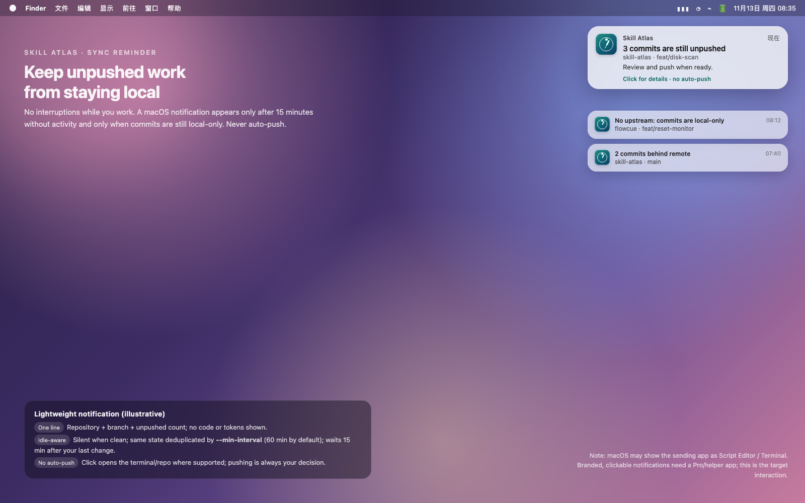

# Pro proposal: branded, actionable sync notifications

Status: **draft for iteration** · Tracking issue: https://github.com/Jorgut/flowcue/issues/4

This document parks the target experience in the repository so later FlowCue Pro work can pick it up without relying on a chat transcript.

*Target mockup. The current Skill Atlas lightweight path sends a macOS notification through `osascript`; the system may show Script Editor as the app name and there are no custom buttons. Pro would own a signed notification surface with actions and deep links.*

## Problem

Skill Atlas (open, free) can already detect unpushed, local-only, behind-remote and detached-HEAD states through `sync status` / `sync notify` (0.12.x, JSON contract). Its lightweight notification is deliberately unbranded and transient:

- App name may appear as **Script Editor**;
- no **Open repository** / **Snooze** actions;
- no menu-bar badge or multi-repo overview;
- easy to miss while working.

## Proposed split

| Layer | Owner | Content |
|---|---|---|
| Open core | Skill Atlas | `sync status` / `sync notify`, registry + worktree checks, optional fetch, stable JSON |
| Pro surface | FlowCue Pro | Branded notification, actions, click-to-open, snooze/ignore, menu bar, quiet hours, multi-repo history |
| Integration | JSON contract | FlowCue consumes Skill Atlas CLI/JSON; no repository merge; no auto-push |

## Phases

1. **Validate** — use the free `sync notify` for a couple of weeks; confirm the annoyance/action rate before building UI.
2. **MVP Pro** — signed `UNUserNotificationCenter` surface; `Open repository`, `Snooze 1h`; click opens terminal/editor; repo + branch + reason only.
3. **Control surface** — menu bar badge, per-repo mute, quiet hours, digest, shared dedupe with Skill Atlas.
4. **Optional team** — cross-device preferences or team policy only after Phases 1–2 show demand.

## Decisions to settle

- Bundle with FlowCue Pro or a separate helper app?
- Free/Pro boundary: basic CLI stays free; branded actions/menu bar are candidates for Pro.
- One registry owned by Skill Atlas vs FlowCue vs shared file.
- Deep-link scheme (`flowcue://...`) and notifying app name (FlowCue or Skill Atlas).
- Minimum macOS version, Developer ID signing/notarization, App Store implications.
- Reuse Skill Atlas's `~/.cache/skill-atlas/sync-notify.json` or keep a FlowCue state file with the same semantics.

## Guardrails

- No automatic `git push`, commit, rebase or fetch.
- No code, diff, credentials or session text in notifications/logs.
- Local-first by default; no server upload.
- Explicit project registry, not silent scanning of every repository.
- Never present the Pro surface as required for basic push checks.

## References

- Skill Atlas `sync notify` docs: https://github.com/Jorgut/skill-atlas/blob/main/docs/sync-notify.md
- Skill Atlas implementation: https://github.com/Jorgut/skill-atlas/pull/26
- FlowCue tracking issue: https://github.com/Jorgut/flowcue/issues/4
